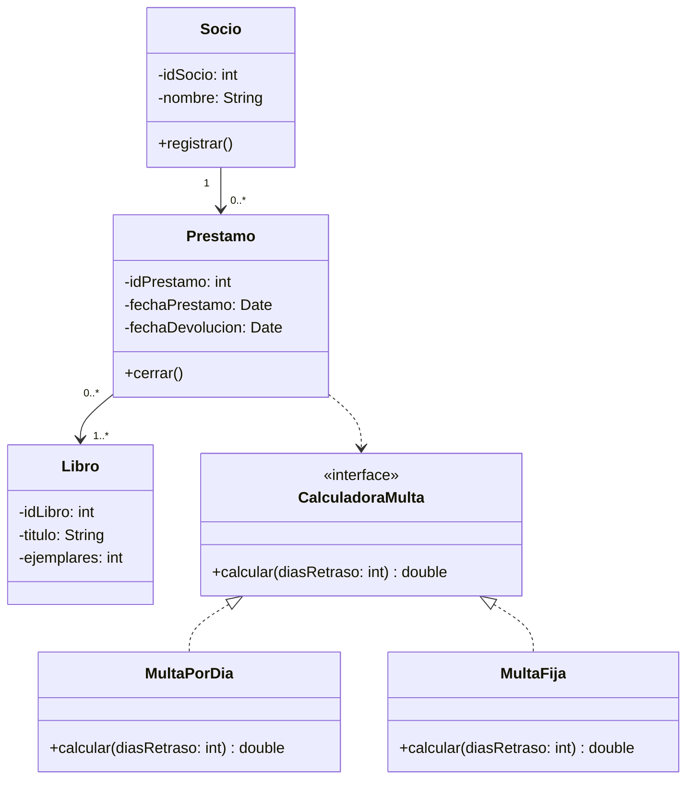
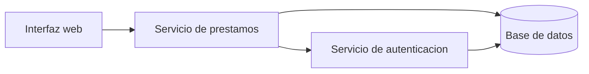
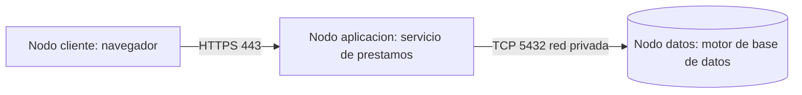

# Plantillas y ejemplos pequeños · Guía 2: Diseño de la solución (v2)

**Ficha 3413974 · Análisis y Desarrollo de Software · Competencia 220501095 (Modelado de los artefactos del software)**

Este archivo reúne los formatos que la guía menciona (lista de chequeo, matriz de trazabilidad, cuadro de reglas de transformación, tabla de decisiones de arquitectura, diccionario, registro de hallazgos) y un ejemplo pequeño de cada uno en un dominio **distinto** de los casos de tu proyecto y de las pruebas: una biblioteca de barrio que presta libros. Es solo un modelo de **forma**: tus artefactos deben salir de **tu** informe de análisis, con tus requisitos, tus clases y tus tablas. Copiar el ejemplo como si fuera tuyo no cuenta como artefacto entregado.

Las plantillas se pueden copiar a un `.md` de tu carpeta G2-P1 o G2-P2 y diligenciar. Los mínimos exigidos están en **Rubricas_G2.md**.

---

## 0. Caso del ejemplo: «Biblioteca de barrio» (extracto del análisis)

| ID | Requisito |
|---|---|
| RF-01 | Registrar socios con documento, nombre y uno o más teléfonos. |
| RF-02 | Registrar libros con título, autor y número de ejemplares. |
| RF-03 | Prestar uno o más ejemplares a un socio, con fecha de devolución. |
| RF-04 | Registrar la devolución y calcular la multa por días de retraso. |
| RNF-01 | La consulta del catálogo responde en 2 segundos o menos con 30 usuarios simultáneos. |
| RNF-02 | Los datos personales de los socios se acceden solo por roles autorizados. |

---

## 1. Ficha de interpretación y plataforma (A1)

| Elemento | Qué se escribe | Ejemplo |
|---|---|---|
| Requisitos funcionales seleccionados | ID y texto corto (≥ 8) | RF-03 Prestar ejemplares con fecha de devolución |
| Requisitos no funcionales (≥ 3) | ID, texto y métrica | RNF-01 consulta ≤ 2 s con 30 usuarios |
| Actores | Quién usa el sistema | Socio, bibliotecario |
| Restricciones | Presupuesto, equipo, plazo | Un servidor pequeño; equipo de 3 personas |
| Lenguaje orientado a objetos y justificación | ≥ 3 condiciones del caso | Java: el equipo lo conoce; hay librerías de acceso a datos; corre en el servidor pequeño |
| Tipo de base de datos y justificación | Relacional o no relacional y por qué | Relacional: los préstamos exigen consistencia y las relaciones socio-libro-préstamo son fijas |

---

## 2. Diagrama de clases (A2) y patrones (A3): formato

Un archivo `.md` con el diagrama (fuente editable) y una tabla. Ejemplo reducido en Mermaid, un miembro por línea:



| Patrón | Problema concreto del caso | Por qué ese patrón | Clases que lo implementan | Qué mejora en mantenibilidad |
|---|---|---|---|---|
| Estrategia | La multa puede cambiar por política de la biblioteca | Separa el cálculo de la clase `Prestamo` | `CalculadoraMulta`, `MultaPorDia`, `MultaFija` | Una nueva política se agrega sin modificar `Prestamo` |

Nota: la interfaz con dos implementaciones muestra el **polimorfismo**: `Prestamo` llama `calcular` sin saber cuál implementación recibe.

---

## 3. Arquitectura (A4): tabla de decisiones

| RNF | Decisión de diseño | Alternativa descartada | Razón del descarte |
|---|---|---|---|
| RNF-01 consulta ≤ 2 s | Índices en la tabla de libros y caché del catálogo en el servicio | Consultar directamente la tabla sin índice | No garantiza el tiempo con 30 usuarios |
| RNF-02 acceso por rol | Componente de autenticación y autorización entre la interfaz y los servicios | Validar roles solo en la pantalla | Se puede saltar llamando al servicio |
| (estilo) tres capas | Presentación, lógica y datos; la presentación solo llama a la lógica | Monolito en una sola capa | Mezcla responsabilidades y complica el cambio |

También se escribe el estilo de comunicación entre componentes (por ejemplo, llamadas HTTP con JSON) y se dibuja el diagrama del estilo sin capas saltadas.

---

## 4. Vista de componentes (A5)

Formato: componentes con interfaces provistas y requeridas, dependencias con dirección, y una tabla de mapeo.



| Componente | Interfaz que provee | Interfaz que requiere | Clases que agrupa | Requisitos que atiende |
|---|---|---|---|---|
| Servicio de prestamos | `IPrestamos` | `IAutorizacion`, `IDatos` | `Prestamo`, `CalculadoraMulta` | RF-03, RF-04 |
| Servicio de autenticacion | `IAutorizacion` | `IDatos` | `Socio`, `Rol` | RNF-02 |

---

## 5. Vista de despliegue (A6)



| Nodo | Artefactos que aloja | Conexión (protocolo y puerto) | Decisión que responde a un RNF |
|---|---|---|---|
| Cliente | Aplicación web (navegador) | HTTPS 443 hacia aplicación | RNF-02: datos personales en tránsito cifrados |
| Aplicación | Servicios de préstamos y autenticación | TCP 5432 hacia datos | RNF-01: caché del catálogo |
| Datos | Motor de base de datos | Solo acepta conexiones de la aplicación | RNF-02: base sin exposición a internet |

---

## 6. Matriz de trazabilidad (A7)

| Requisito | Clase(s) | Tabla(s) | Componente(s) | Decisión |
|---|---|---|---|---|
| RF-01 | `Socio` | `socio`, `telefono_socio` | Servicio de autenticacion | |
| RF-03 | `Prestamo`, `Libro` | `prestamo`, `prestamo_libro` | Servicio de prestamos | |
| RF-04 | `Prestamo`, `CalculadoraMulta` | `prestamo` (con `fecha_devolucion_real`) | Servicio de prestamos | Estrategia |
| RNF-02 | n/a | n/a | Servicio de autenticacion | Autorización por rol |

Revisa la matriz en **dos sentidos**: cada requisito debe llegar a un artefacto (hacia adelante) y cada clase o tabla debe responder a un requisito (hacia atrás). Una clase sin requisito se pregunta al analista o se retira.

---

## 7. Modelo conceptual y cuadro de reglas de transformación (B1, B2)

| Regla | Caso del ejemplo | Resultado en el modelo lógico |
|---|---|---|
| Relación N:M se resuelve con tabla intermedia | Un préstamo incluye varios libros y un libro está en varios préstamos | `prestamo_libro(id_prestamo FK, id_libro FK)`, PK compuesta |
| Relación 1:N: la FK va en el lado «muchos» | Un socio tiene varios préstamos | `prestamo.id_socio FK` |
| Relación 1:1: FK única | Un socio tiene una credencial de acceso | `credencial.id_socio FK UNIQUE` |
| Atributo multivaluado: tabla aparte | Un socio tiene varios teléfonos | `telefono_socio(id_telefono PK, id_socio FK, numero)` |
| Relación recursiva (si existe) | Un socio es recomendado por otro socio | `socio.id_recomendado FK` hacia `socio` |
| Generalización (si existe) | `SocioAdulto` y `SocioInfantil` | Una tabla `socio` con tipo, o una tabla por subtipo, justificada |

---

## 8. Normalización paso a paso (B3)

Ejemplo con una tabla de partida (0FN). Se escriben las **dependencias funcionales (DF)** y el estado antes y después de cada paso.

**0FN:** `prestamo_detalle(id_prestamo, id_libro, id_socio, nombre_socio, telefonos, titulo, editorial, ciudad_editorial, pais_editorial, fecha_prestamo)` con llave (`id_prestamo`, `id_libro`); `telefonos` trae varios valores separados por coma.

| Paso | Violación | DF escritas | Resultado |
|---|---|---|---|
| 1FN | `telefonos` no es atómico | | `telefono_socio(id_telefono, id_socio, numero)` y la columna sale de la tabla |
| 2FN (dependencia parcial, llave compuesta) | `titulo` y `editorial` dependen solo de `id_libro`; `id_socio`, `nombre_socio` y `fecha_prestamo` dependen solo de `id_prestamo` | `id_libro → titulo, editorial` · `id_prestamo → id_socio, fecha_prestamo` | Tablas `libro`, `prestamo` y `prestamo_libro(id_prestamo, id_libro)` |
| 3FN (dependencia transitiva) | `pais_editorial` depende de `ciudad_editorial`, y esta de `editorial` | `editorial → ciudad_editorial → pais_editorial` · `id_socio → nombre_socio` | Tablas `editorial(id_editorial, nombre, ciudad, pais)` y `socio` |

Si desnormalizas algo a propósito, se justifica por escrito (por ejemplo, un total precalculado por rendimiento) y se declara dónde.

---

## 9. Diccionario de datos (B4)

Estándar de nombrado declarado: tablas en singular, columnas en `snake_case`, llaves `id_<tabla>`.

| Tabla | Columna | Tipo | Tamaño | Restricciones | Dominio / regla |
|---|---|---|---|---|---|
| `socio` | `id_socio` | INTEGER | n/a | PK, autoincremental | Entero positivo |
| `socio` | `documento` | VARCHAR | 15 | NOT NULL, UNIQUE | Solo dígitos |
| `prestamo` | `fecha_devolucion` | DATE | n/a | NOT NULL, CHECK (`fecha_devolucion` >= `fecha_prestamo`) | Fecha de devolución prevista |
| `prestamo` | `id_socio` | INTEGER | n/a | FK → `socio.id_socio`, NOT NULL, ON DELETE RESTRICT | Socio existente |

El diccionario debe coincidir con el modelo y con el script SQL (mismos nombres y tipos).

---

## 10. Script SQL (B5): fragmento de forma

```sql
CREATE TABLE socio (
  id_socio  INTEGER PRIMARY KEY,
  documento VARCHAR(15) NOT NULL UNIQUE,
  nombre    VARCHAR(80) NOT NULL
);

CREATE TABLE prestamo (
  id_prestamo       INTEGER PRIMARY KEY,
  id_socio          INTEGER NOT NULL,
  fecha_prestamo    DATE NOT NULL,
  fecha_devolucion  DATE NOT NULL,
  CONSTRAINT fk_prestamo_socio FOREIGN KEY (id_socio)
    REFERENCES socio (id_socio) ON DELETE RESTRICT,
  CONSTRAINT ck_fechas CHECK (fecha_devolucion >= fecha_prestamo)
);
```

La evidencia de ejecución es una captura o un log del motor donde se ve que no hubo errores.

---

## 11. Políticas de seguridad y matriz de roles (B6)

| Principio | Política (medida concreta sobre el caso) |
|---|---|
| Integridad | `CHECK` en fechas de `prestamo`; llaves foráneas con `ON DELETE RESTRICT` |
| Integridad | Cambios de multas registrados con usuario y fecha |
| Confidencialidad | Contraseñas con hash y sal (no cifradas); documento y teléfono cifrados en la columna |
| Confidencialidad | Datos personales: finalidad informada y autorización previa del titular; tráfico por TLS |
| Disponibilidad | Respaldo automático diario y copia en otro nodo |
| Disponibilidad | Prueba de restauración cada mes con acta |

| Rol | `socio` | `prestamo` | `libro` | `multa` |
|---|---|---|---|---|
| Bibliotecario | SELECT, INSERT, UPDATE | SELECT, INSERT, UPDATE | SELECT, INSERT, UPDATE | SELECT, INSERT |
| Socio | SELECT (solo su fila) | SELECT (solo los suyos) | SELECT | SELECT (solo las suyas) |
| Administrador | SELECT, UPDATE | SELECT | SELECT, UPDATE, DELETE | SELECT, UPDATE |

---

## 12. Lista de chequeo (B7 y prueba de desempeño)

Plantilla: criterios medibles agrupados por artefacto, con severidad (crítico, mayor, menor), el resultado y la **evidencia** (a qué elemento del artefacto remite la marca).

| ID | Artefacto | Criterio de aceptación (medible) | Severidad | Cumple | Evidencia |
|---|---|---|---|---|---|
| LC-01 | Clases | Cada clase traza a ≥ 1 requisito de la matriz | Mayor | Sí / No | Fila de la matriz o clase sin requisito |
| LC-02 | Clases | Ninguna clase mezcla interfaz, lógica, persistencia y notificación | Mayor | | Clase y métodos revisados |
| LC-03 | Clases | Todas las asociaciones traen multiplicidad en los dos extremos | Menor | | |
| LC-04 | Datos | Toda tabla tiene PK y toda relación 1:N tiene FK | Crítico | | |
| LC-05 | Datos | No hay columnas con varios valores en una celda (1FN) | Crítico | | |
| LC-06 | Arquitectura | La presentación no accede directamente a la base de datos | Crítico | | Dependencias del diagrama de componentes |
| LC-07 | Despliegue | Cada conexión indica protocolo o puerto | Menor | | |
| LC-08 | Seguridad | Existe una decisión visible para cada RNF de seguridad | Mayor | | |

Una lista completa agrupa estos criterios por artefacto: clases, patrones, arquitectura, componentes, despliegue, modelo, diccionario y seguridad.

---

## 13. Registro de hallazgos (prueba de desempeño y B7)

| ID | Artefacto | Descripción del hallazgo | Requisito afectado | Severidad | Corrección propuesta |
|---|---|---|---|---|---|
| H-01 | Modelo de datos | `telefonos` guarda varios valores en una celda | RF-01 | Crítico | Tabla `telefono_socio(id_telefono, id_socio, numero)` |
| H-02 | Componentes | La interfaz web consulta la base sin pasar por el servicio | RNF-02 | Crítico | Eliminar la dependencia; la interfaz llama al servicio |
| H-03 | Clases | La clase `Socio` guarda la multa y el reporte mensual | Cohesión | Mayor | Mover esas responsabilidades a clases propias |

La severidad debe ser coherente: lo que rompe un requisito o la integridad es crítico; lo que afecta la calidad pero no el funcionamiento es mayor o menor. Cada hallazgo se anota **en el momento** en que se encuentra.

---

## 14. Entrega de la prueba de desempeño (en computador y en Moodle)

La prueba de desempeño se hace en computador (el del ambiente o tu portátil) y se entrega subiendo archivos a una tarea de Moodle (Zajuna). Usa la herramienta de diagramación, la ofimática y el motor SQL (SQLite, MySQL o PostgreSQL) que ya conoces. Al terminar, comprime una carpeta con esta forma y súbela como `G2-desempeno-<variante>.zip` (la plataforma ya registra quién la sube; no pongas tu nombre en los archivos):

```
G2-desempeno-<variante>/
  01-lista-de-chequeo.md        (o .xlsx / .ods / .docx; ver la plantilla de la sección 12)
  02-registro-de-hallazgos.md   (o .xlsx / .ods / .docx; ver la plantilla de la sección 13)
  03-modelo-normalizado.sql     (o un .md con las tablas, PK, FK y tipos)
  04-diagrama-de-clases.md      (fuente editable del diagrama ajustado)
  04-diagrama-de-clases.png     (imagen exportada)
```

La lista de chequeo y el registro de hallazgos se llenan durante la práctica, no al final. Si el motor SQL te lo permite, comprueba que el script del modelo normalizado se ejecuta sin errores antes de subirlo.
