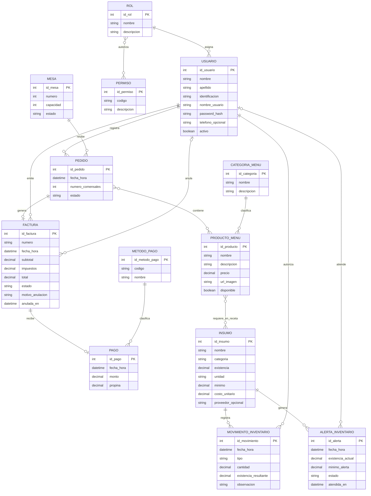

# B1 · Modelo conceptual SIGRES

## Alcance y tipo de base de datos

Se conserva el caso SIGRES y se selecciona una base de datos relacional MySQL 8.0.16 o superior, permitido por RNF-29. Las relaciones entre pedidos, detalles, mesas, productos, facturas, pagos e inventario requieren claves foráneas e integridad transaccional (RNF-19).

El modelo ajusta el MER de G1 con los requisitos detallados del SRS. RF-10 exige descontar insumos cuando se confirma un pedido; por eso se modela la receta producto-insumo, cuya cantidad debe configurarse para cada restaurante.

## Diagrama entidad-relación conceptual

La relación Pedido-ProductoMenu tiene los atributos de línea `numero_linea`, `cantidad`, `precio_unitario` y `nota`; se convierte en `detalle_pedido` en el modelo lógico. ProductoMenu-Insumo tiene `cantidad_por_producto` y se convierte en `producto_insumo`. Rol-Permiso se convierte en `rol_permiso`.

## Cardinalidades mínimas y máximas

| Relación | Cardinalidad de A a B | Verbo / regla |
|---|---|---|
| Rol-Usuario | Rol 0..N usuarios; usuario 1..1 rol | El administrador asigna un rol a cada usuario (RF-01, RF-03). |
| Rol-Permiso | Rol 0..N permisos; permiso 0..N roles | Los roles agrupan permisos (RF-03); relación N:M. |
| Usuario-Pedido | Usuario 0..N pedidos; pedido 1..1 usuario | Un mesero registra cada pedido (RF-04). |
| Mesa-Pedido | Mesa 0..N pedidos; pedido 1..1 mesa | Cada pedido se registra para una mesa (RF-04, RF-14). |
| Pedido-ProductoMenu | Pedido 1..N productos; producto 0..N pedidos | El pedido contiene líneas de productos; relación N:M resuelta con `detalle_pedido` (RF-04). |
| CategoriaMenu-ProductoMenu | Categoría 0..N productos; producto 1..1 categoría | La categoría organiza cada producto (RF-08, RF-09, RF-16). |
| Pedido-Factura | Pedido 0..1 factura; factura 1..1 pedido | Se genera como máximo una factura por pedido (RF-12). |
| Usuario-Factura (emite) | Usuario 0..N facturas; factura 1..1 cajero | Se conserva el empleado que emite cada factura (RF-12, RNF-01). |
| Usuario-Factura (anula) | Usuario 0..N anulaciones; factura 0..1 usuario anulador | Solo un Administrador puede anular una factura y debe quedar identificado (regla SRS). |
| Factura-Pago | Factura 0..1 pago; pago 1..1 factura | Supuesto de P1: no se modelan pagos parciales (RF-13). |
| MetodoPago-Pago | Método 0..N pagos; pago 1..1 método | Cada pago registra el método utilizado (RF-13). |
| ProductoMenu-Insumo | Producto 0..N insumos; insumo 0..N productos | La receta especifica la cantidad de cada insumo por producto; relación N:M (RF-10). |
| Insumo-MovimientoInventario | Insumo 0..N movimientos; movimiento 1..1 insumo | Cada cambio de existencias deja un movimiento (RF-10). |
| Usuario-MovimientoInventario | Usuario 0..N movimientos; movimiento 1..1 usuario | Se conserva quién registró o confirmó el movimiento (RF-10). |
| Insumo-AlertaInventario | Insumo 0..N alertas; alerta 1..1 insumo | Cada alerta corresponde a un insumo (RF-11). |
| Usuario-AlertaInventario | Usuario 0..N alertas atendidas; alerta 0..1 usuario | Se conserva quién atendió la alerta (RF-11). |

## Entidades y trazabilidad

| Entidad | Identificador y atributos principales | Requisito(s) |
|---|---|---|
| Rol | `id_rol`; nombre, descripción | RF-01, RF-02, RF-03; RNF-01 |
| Usuario | `id_usuario`; nombre, apellido, identificación, usuario, hash de contraseña, teléfono opcional, activo | RF-01, RF-02, RF-03; RNF-01 |
| Permiso | `id_permiso`; código, descripción | RF-03; RNF-01 |
| Mesa | `id_mesa`; número, capacidad, estado | RF-04, RF-14, RF-17 |
| CategoriaMenu | `id_categoria`; nombre, descripción | RF-08, RF-09, RF-16 |
| ProductoMenu | `id_producto`; nombre, descripción, precio, imagen, disponibilidad | RF-04, RF-08, RF-09, RF-16 |
| Pedido | `id_pedido`; fecha, comensales, estado | RF-04, RF-05, RF-06, RF-07, RF-14, RF-17 |
| Factura | `id_factura`; número, fecha, importes, estado y datos de anulación | RF-12, RF-13, RF-15, RF-17 |
| MetodoPago | `id_metodo_pago`; código, nombre | RF-13 |
| Pago | `id_pago`; fecha, monto, propina | RF-13, RF-15 |
| Insumo | `id_insumo`; nombre, categoría, existencia, unidad, mínimo, costo, proveedor opcional | RF-10, RF-11 |
| MovimientoInventario | `id_movimiento`; fecha, tipo, cantidad, saldo resultante, observación | RF-10 |
| AlertaInventario | `id_alerta`; fecha, saldo y mínimo al generar, estado, atención opcional | RF-11 |

`DetallePedido`, `ProductoInsumo` y `RolPermiso` son relaciones asociativas que se materializan como tablas en B2. El cliente QR no se representa como entidad porque el SRS indica acceso público sin registro y prohíbe almacenar sus datos personales. No se identifican relaciones recursivas ni generalizaciones en el alcance del SRS.