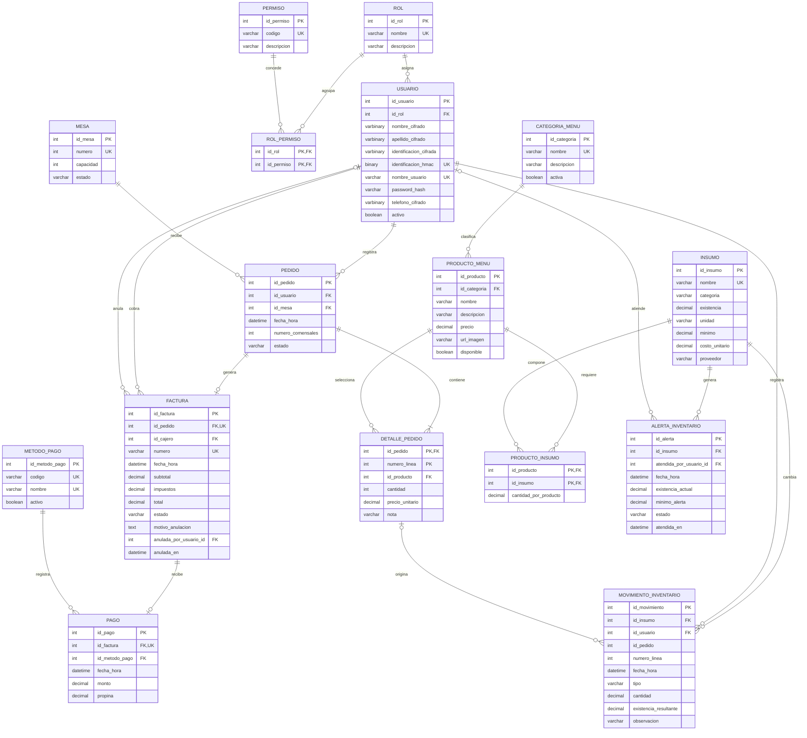

# B2 · Modelo lógico relacional SIGRES

**Motor elegido:** MySQL 8.0.16 o superior, InnoDB, `utf8mb4`.  
**Convención:** tablas y columnas en singular `snake_case`; PK `id_<tabla>`; las relaciones N:M usan tablas asociativas.

## Diagrama lógico

## Esquema de tablas

| Tabla | Columnas, PK y FK |
|---|---|
| `rol` | `id_rol` PK, `nombre` UNIQUE, `descripcion` |
| `permiso` | `id_permiso` PK, `codigo` UNIQUE, `descripcion` |
| `usuario` | `id_usuario` PK, `id_rol` FK → `rol`, nombre, apellido e identificación cifrados, HMAC único de identificación, nombre de usuario, hash de contraseña, teléfono cifrado opcional, estado |
| `rol_permiso` | `(id_rol, id_permiso)` PK compuesta; ambas columnas FK |
| `mesa` | `id_mesa` PK, `numero` UNIQUE, capacidad, estado |
| `categoria_menu` | `id_categoria` PK, nombre UNIQUE, descripción, activa |
| `producto_menu` | `id_producto` PK, `id_categoria` FK → `categoria_menu`, nombre, descripción, precio, URL de imagen, disponible; UNIQUE (`id_categoria`, `nombre`) |
| `pedido` | `id_pedido` PK, `id_usuario` FK → `usuario`, `id_mesa` FK → `mesa`, fecha, comensales, estado |
| `detalle_pedido` | `(id_pedido, numero_linea)` PK compuesta; `id_pedido` FK → `pedido`; `id_producto` FK → `producto_menu`; cantidad, precio vendido, nota |
| `factura` | `id_factura` PK, `numero` UNIQUE, `id_pedido` FK UNIQUE → `pedido`, `id_cajero` FK → `usuario`, fecha, importes, estado y datos de anulación |
| `metodo_pago` | `id_metodo_pago` PK, código y nombre UNIQUE, activo |
| `pago` | `id_pago` PK, `id_factura` FK UNIQUE → `factura`, `id_metodo_pago` FK → `metodo_pago`, fecha, monto, propina |
| `insumo` | `id_insumo` PK, nombre UNIQUE, categoría, existencia, unidad, mínimo, costo unitario, proveedor opcional |
| `producto_insumo` | `(id_producto, id_insumo)` PK compuesta; ambas FK; cantidad de insumo usada por producto |
| `movimiento_inventario` | `id_movimiento` PK, FK a `insumo` y `usuario`; FK compuesta opcional (`id_pedido`, `numero_linea`) → `detalle_pedido`; fecha, tipo, cantidad, saldo resultante |
| `alerta_inventario` | `id_alerta` PK, `id_insumo` FK → `insumo`, usuario que atiende opcional FK → `usuario`, fecha, saldos observados, estado y fecha de atención |

## Reglas de transformación aplicadas

| Regla | Aplicación en B1 | Resultado |
|---|---|---|
| Entidad fuerte | Rol, permiso, usuario, mesa, categoría, producto, pedido, factura, pago, método, insumo, movimiento y alerta | Una tabla con PK propia por entidad. |
| Relación 1:N | Rol-Usuario; Usuario-Pedido; Mesa-Pedido; Categoría-Producto; Insumo-Movimiento | La FK se ubica en el lado N: por ejemplo, `pedido.id_mesa`. |
| Relación 1:1 opcional | Pedido-Factura | `factura.id_pedido` es FK `UNIQUE`; un pedido puede no tener factura o tener una. |
| Relación 1:1 opcional | Factura-Pago | `pago.id_factura` es FK `UNIQUE`; refleja el supuesto de P1 de un solo pago por factura. |
| Relación N:M | Rol-Permiso | Tabla intermedia `rol_permiso` con PK compuesta. |
| Relación N:M con atributos | Pedido-ProductoMenu | Tabla `detalle_pedido`; clave compuesta por pedido y número de línea. Conserva cantidad, nota y precio histórico. |
| Relación N:M con atributos | ProductoMenu-Insumo | Tabla `producto_insumo`; cantidad requerida por unidad del producto. Permite calcular el descuento exigido por RF-10. |
| FK compuesta opcional | DetallePedido-MovimientoInventario | Un movimiento automático puede apuntar a la línea que lo originó; las entradas manuales no llevan pedido ni línea. |
| Atributo multivaluado | No hay un atributo con varios valores indivisibles en el SRS | El teléfono de empleado es opcional y singular; los productos de un pedido se normalizan mediante `detalle_pedido`. |
| Recursividad / generalización | No identificadas en el alcance SIGRES | No se agrega una relación o jerarquía sin sustento del SRS. |
| Reporte calculado | RF-15 | Vista `vw_reporte_ventas`, no tabla de almacenamiento. |

## Reglas de negocio que no caben en una FK

- Al confirmar un pedido, en una transacción se guarda el pedido, sus detalles, los movimientos de salida calculados con `producto_insumo` y el nuevo saldo de cada insumo. Si una salida deja saldo negativo, se revierte la operación.
- El precio de `detalle_pedido` es una copia histórica del precio de menú al confirmar el pedido; no se actualiza al cambiar el precio del producto.
- Una factura tiene el estado `Pendiente`, `Pagada` o `Anulada`. Una factura pagada no se modifica; solo el Administrador puede anularla con motivo.
- No se almacena información personal del cliente QR. La consulta del consumo se limita al pedido activo asociado a la mesa identificada por el QR.
- La vista de reportes considera facturas pagadas y permite filtrar por fechas, producto y mesero.
